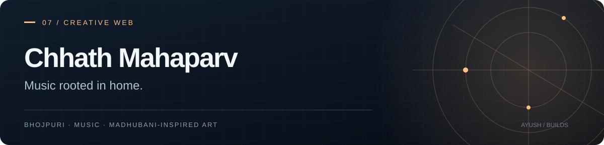

# Chhath Mahaparv
### A music experience rooted in home.

A browser-based Chhath music player with Bhojpuri interface copy, a sunrise introduction, and Madhubani-inspired visuals. Listen through YouTube or add audio files from your own device.

**HTML · CSS · JavaScript · YouTube playback · Local audio**


> **[Step-by-step user guide (PDF)](docs/USER_GUIDE.pdf)**

## The experience

- A skippable introduction following the four days of Chhath.
- Song and artist search, a library view, and shuffle.
- Playback controls with seeking and previous/next tracks.
- Local audio import for recordings already on your device.
- Reduced-motion handling in the interface.

## Run locally

No package installation or build step is required.

```sh
git clone https://github.com/AyushKJha/chatt-mahaparv.git
cd chatt-mahaparv
python -m http.server 8000 --bind 127.0.0.1
```

Open http://localhost:8000. YouTube playback and externally hosted fonts need an internet connection.

## Source map

| File | Role |
| --- | --- |
| [index.html](index.html) | Page, dialogs, and Bhojpuri interface text |
| [music-data.js](music-data.js) | Curated song records |
| [app.js](app.js) | Player controls and library |
| [audio-library.js](audio-library.js) | Device-local audio import |
| [intro.js](intro.js) | Sunrise introduction |
| [style.css](style.css), [cinema.css](cinema.css), [orbit.css](orbit.css) | Layout and visual effects |

## Hosting and media

Serve the repository root as a static site. A public deployment address has not yet been verified for this repository.

Recordings belong to their artists and labels and stream through YouTube. Availability depends on region and embed permissions; use the track's YouTube link if embedded playback is unavailable. Imported audio stays in the browser and is not uploaded.

The sunrise artwork is AI-generated and inspired by Madhubani art. It is shown above as project artwork, not as an application screenshot.
